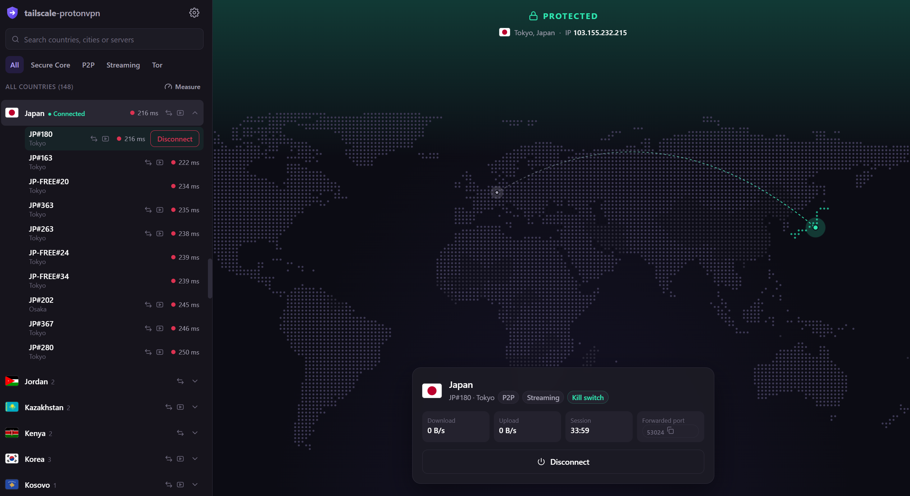

# tailscale-protonvpn

[Tailscale's Mullvad exit nodes](https://tailscale.com/kb/1258/mullvad-exit-nodes), but with ProtonVPN.
Turn any Linux server into a Tailscale exit node that routes through ProtonVPN, so you can pick it on any
of your devices and stay connected to your tailnet the whole time. No separate VPN app fighting with
Tailscale for the network.

- Only exit-node traffic goes through the VPN. The server itself keeps its normal connectivity, so SSH
  and Tailscale keep working.
- Kill switch, port forwarding, and a web dashboard on your tailnet.
- One static binary, one command to install.



## Features

- **Web dashboard**: see at a glance whether you're protected and which IP you exit from, browse
  servers on an interactive world map, filter by Secure Core / P2P / Streaming / Tor, measure
  latency, and connect to the fastest server with one click.
- **Kill switch**: if the tunnel drops, exit-node traffic is blocked instead of leaking from the
  server's real IP. It's in place at boot before Tailscale starts. IPv6 can't bypass the VPN.
- **Port forwarding** (NAT-PMP on P2P servers), auto-renewed. Forward it to the server itself or
  to any device on your tailnet.
- **DNS through the VPN** for exit-node clients only: their lookups leave from the Proton IP (and
  are blocked with the kill switch when the tunnel is down), while the server's own DNS is untouched.
  MagicDNS names keep working.
- **Persistent**: survives reboots. Restarting or upgrading tailscale-protonvpn doesn't drop the tunnel.
- **Private dashboard**: served only on your tailnet via `tailscale serve` (HTTPS, no open ports).

## Requirements

- Linux with systemd and kernel WireGuard (5.6+, or the `wireguard` module). A normal VPS or
  home server is fine; OpenVZ/LXC containers often aren't.
- [Tailscale](https://tailscale.com/download/linux), logged in, running with a TUN device
  (not `--tun=userspace-networking`).
- HTTPS certificates enabled for your tailnet (admin console → DNS) for the dashboard.
- A ProtonVPN plan that includes WireGuard configs. Port forwarding needs a paid plan.

`iproute2` and `iptables` are installed automatically if missing (`iptables-nft` is fine).

## Install

```sh
curl -fsSL https://raw.githubusercontent.com/koguma/tailscale-protonvpn/main/install.sh | sudo sh
```

The script picks the right binary (x86_64 or arm64), verifies its checksum, and runs
`tailscale-protonvpn install`, which:

1. checks the requirements above,
2. enables IP forwarding (`/etc/sysctl.d/99-tailscale-protonvpn.conf`) if it's off,
3. installs `/usr/local/bin/tailscale-protonvpn` and starts `tailscale-protonvpn.service`,
4. advertises the machine as a Tailscale exit node (approve it in the admin console if needed),
5. exposes the dashboard at `https://<machine>.<tailnet>.ts.net` with `tailscale serve`.

Options are passed via `TAILSCALE_PROTONVPN_ARGS`, e.g. if port 443 is already served:

```sh
curl -fsSL https://raw.githubusercontent.com/koguma/tailscale-protonvpn/main/install.sh | sudo TAILSCALE_PROTONVPN_ARGS="--https-port 8443" sh
```

## Set up

1. Open the dashboard URL printed by the installer.
2. On [account.protonvpn.com/downloads](https://account.protonvpn.com/downloads), create a
   **WireGuard configuration** for **Linux** with **NAT-PMP (Port Forwarding)** turned on (any server).
3. Paste it into the dashboard (Settings → WireGuard key). One key works with every Proton server.
4. Hit **Quick Connect** or pick a server.
5. On your devices, select this machine as the Tailscale exit node.

## Usage

| Command | |
|---|---|
| `sudo tailscale-protonvpn install` | install or upgrade (re-run the installer to upgrade) |
| `sudo tailscale-protonvpn uninstall [--purge]` | remove the service, routing and dashboard; `--purge` also deletes the saved key |
| `sudo tailscale-protonvpn up` | start again after `down`, and wait until the VPN is connected |
| `sudo tailscale-protonvpn down` | emergency off: stop the service and remove the tunnel/routing (traffic goes direct). `systemctl start tailscale-protonvpn` brings it back; it also returns on reboot |
| `tailscale-protonvpn version` | print version |
| `journalctl -u tailscale-protonvpn -f` | logs |

The forwarded port is also written to `/run/tailscale-protonvpn/forwarded_port` for scripts.

To limit the dashboard to specific Tailscale users, add `--allow-users you@example.com` to the
`ExecStart` line in `/etc/systemd/system/tailscale-protonvpn.service`.

## How it works

tailscale-protonvpn is a controller. The data path is the kernel's own WireGuard and policy routing, so
nothing breaks if the process stops. Every 5 seconds (and on every change) it converges the system
onto the desired state:

- **Tunnel**: WireGuard interface `pvpn0` with your key and the chosen server as its only peer.
  Switching servers only swaps the peer.
- **Routing** (table `51820`, next to Tailscale's own rules):

  | pref | rule | purpose |
  |---|---|---|
  | 5199 | `ipproto udp sport <forwarded port>` → tunnel | UDP replies from apps receiving the forwarded port |
  | 5200 | `fwmark 0xca6c` → tunnel | tailscale-protonvpn's own probes (NAT-PMP, exit-IP check) |
  | 5209 | `from <tunnel IP>` → tunnel | replies from services receiving the forwarded port |
  | 5270 | *(Tailscale)* `lookup 52` | tailnet destinations stay on the tailnet |
  | 5275 | `iif tailscale0` → tunnel | **exit-node traffic into the VPN** |
  | 5276 | `iif tailscale0 prohibit` | **kill switch**; always on for IPv6 when the tunnel has none |

- **Firewall**: its own iptables chains (`PE-*`): masquerade into the tunnel, drop unsolicited
  inbound traffic except the forwarded port, MSS clamping, port-forward redirect/DNAT.
  For DNS, `PE-DNS` (mangle `OUTPUT`) marks tailscaled's plain port-53 queries, which are the
  ones it forwards for exit-node clients, with `0xca6c` so they take the tunnel. They're matched by
  tailscaled's bypass mark (TCP) and its cgroup (UDP is sent unmarked), and dropped instead while
  the kill switch is blocking. The server's own lookups go out as DoH (with Cloudflare-style tailnet
  resolvers) and aren't matched, except Tailscale's plain-DNS retry when DoH takes over 500 ms.
- **Port forwarding**: NAT-PMP requests to `10.2.0.1` every 45 s, always as `internal 1 / external 0`
  (Proton then keeps the same public port; other requests use up its mapping quota). Arriving
  traffic is redirected to the public port number, or DNATed to the tailnet target you set.
- **Boot order**: the unit runs `Before=tailscaled`, so the kill switch exists before any exit
  traffic can arrive.
- **Server list**: Proton's API needs a logged-in session (and shows CAPTCHAs to VPS IPs), so the list
  comes from [gluetun](https://github.com/qdm12/gluetun-servers)'s public Proton data. It refreshes
  every 12 h, with a snapshot built into the binary.

State lives in `/var/lib/tailscale-protonvpn/state.json` (mode 0600; it contains the WireGuard private key).

## Build from source

```sh
make build            # ./tailscale-protonvpn for this machine
make dist             # all release binaries + checksums.txt in dist/
make deploy HOST=root@my-server
make snapshot         # refresh the embedded server list
```

### Project layout

```
cmd/tailscale-protonvpn/  main.go: CLI subcommands, the `serve` daemon, install/uninstall/up/down
internal/
  api/                    HTTP API
  controller/             reconcile loop and kill-switch decisions, saved settings
                          (state.go), ProtonVPN server list (servers.go) + snapshot/servers.json
  vpn/                    network plumbing: WireGuard tunnel, policy routing + firewall,
                          NAT-PMP port forwarding, exit-IP/latency probes
  web/                    dashboard (HTML, map data, flags), embedded into the binary
docs/                     README assets
```
